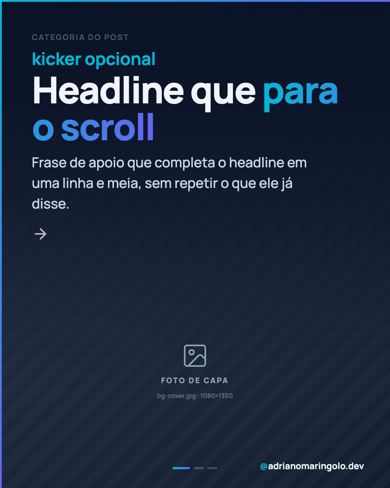
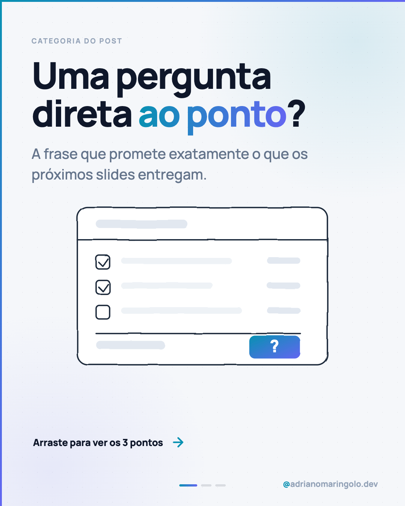
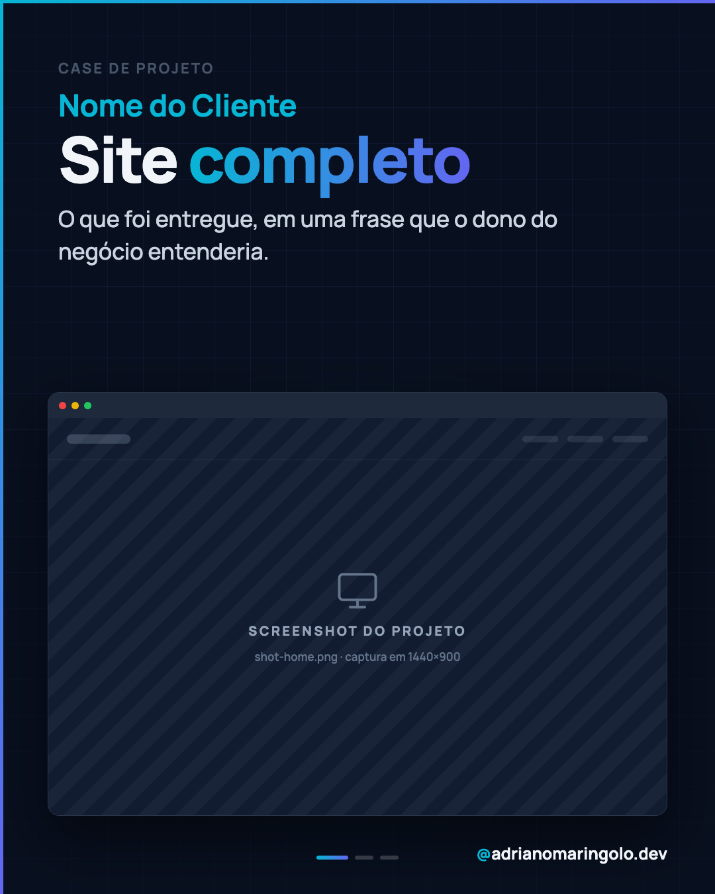
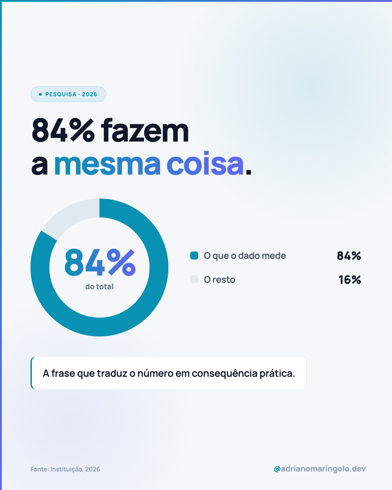
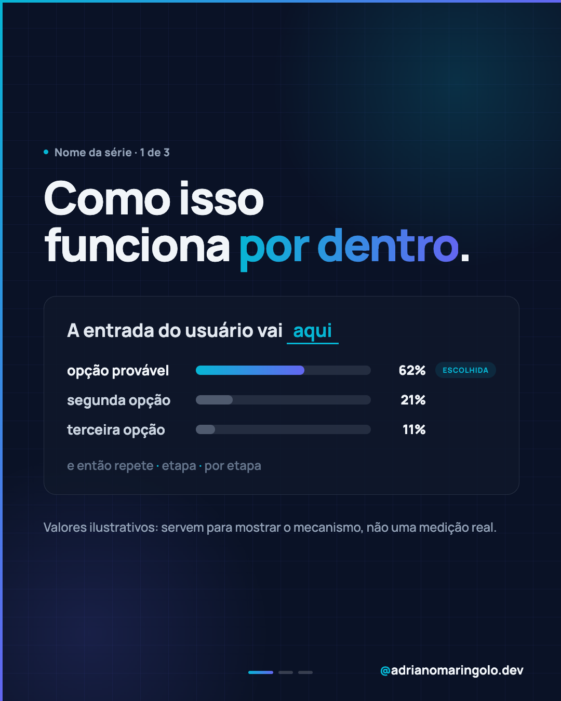
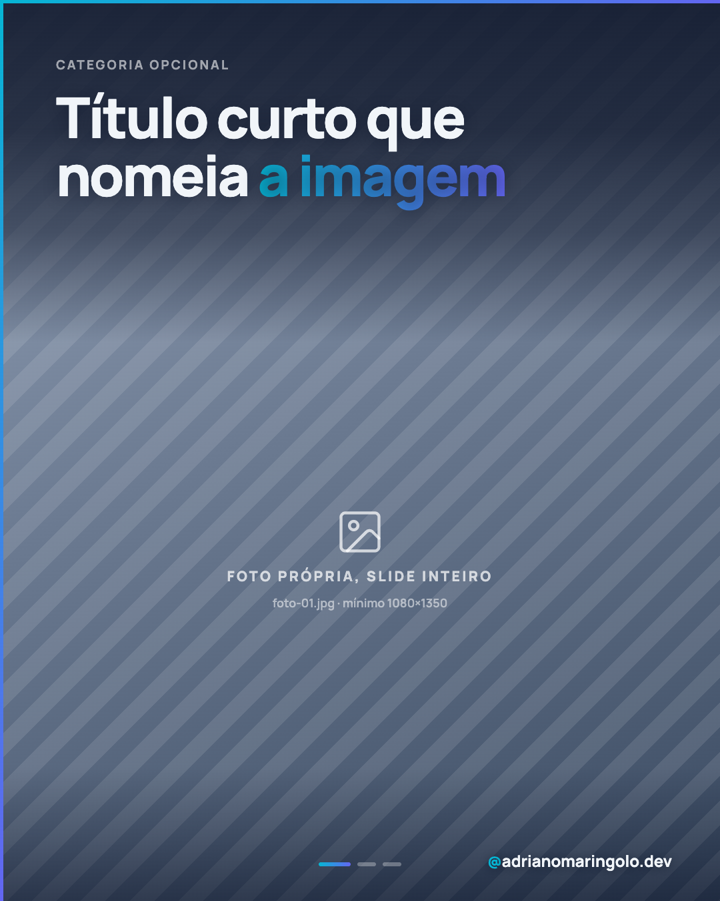
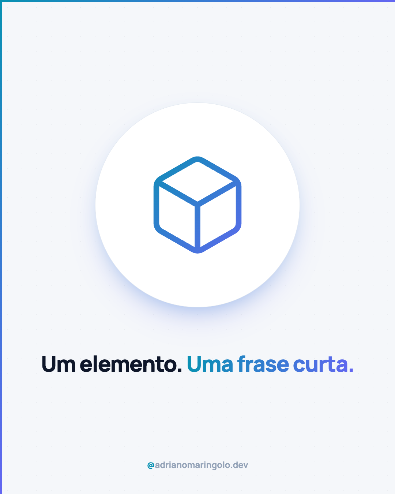
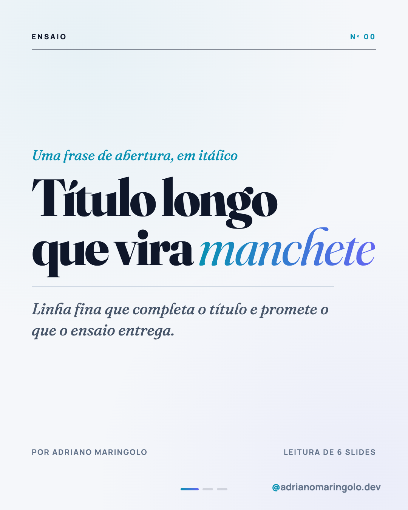

# Templates de post — Instagram @adrianomaringolo.dev

> Este arquivo é o **índice de templates** do projeto. A skill `instagram-post` procura por ele.
> Ao encontrá-lo, a skill **pergunta qual template seguir** antes de desenhar qualquer slide.

Um template define o **esqueleto visual** de um post: como é a capa, como são os slides
internos, como o fecho funciona, que papel a imagem tem e qual a escala tipográfica.
Ele **não** define o conteúdo nem congela o layout: cada template tem uma seção
`Variações permitidas` (o que pode mudar de post pra post) e uma seção `Travas`
(o que nunca muda, sob pena de o feed perder unidade).

Tudo que é comum a **todos** os templates — paleta, fonte, accent borders, progress dots,
handle, regras de export — está em [`../design-system.md`](../design-system.md) e em
[`../BRAND.md`](../BRAND.md). Os arquivos aqui só descrevem o que **diferencia** cada template.

---

## Catálogo

| ID | Nome | Quando usar | Formato | Imagem obrigatória? | Criatividade |
|---|---|---|---|---|---|
| `foto-editorial` | [Foto editorial](foto-editorial.md) | Tema com rosto, ambiente ou objeto real. Conteúdo educativo/opinativo que ganha com foto. | Carrossel 5–9 | **Sim** — foto de capa | 1 · Base |
| `tipografico` | [Tipográfico](tipografico.md) | Conceito, lista, comparativo, número. Quando não existe foto boa e a ideia se sustenta no texto. | Carrossel 5–9 | Não — ilustração SVG opcional | 1 · Base |
| `case-showcase` | [Case / showcase](case-showcase.md) | Apresentar um projeto entregue, produto ou biblioteca. Prova de trabalho. | Carrossel 6–8 | **Sim** — screenshots do projeto | 1 · Base |
| `dado-visual` | [Dado visual](dado-visual.md) | Uma estatística, pesquisa ou número forte é o protagonista. | Único ou carrossel 3–7 | Não — gráfico em CSS/SVG | 1 · Base |
| `explicador-tecnico` | [Explicador técnico](explicador-tecnico.md) | Explicar um mecanismo (como a IA funciona, como um sistema decide). Precisa de diagrama ou interface simulada. | Carrossel 6–9 ou único | Não — diagrama/UI em HTML | 1 · Base |
| `frase-unica` | [Frase única](frase-unica.md) | Uma ideia forte, provocação ou princípio. Ritmo e reforço de posicionamento. | Único (1 slide) | Opcional — foto de fundo | 2 · Expressivo |
| `foto-protagonista` | [Foto protagonista](foto-protagonista.md) | A imagem é o conteúdo. Bastidor, retrato, projeto no mundo real. Só um título no topo. | Único ou carrossel 3–7 | **Sim** — foto própria | 2 · Expressivo |
| `elemento-central` | [Elemento central](elemento-central.md) | Post mínimo: um símbolo no centro + frase de até 10 palavras. Respiro entre carrosséis. | Único (1 slide) | Não — ícone Lucide ou objeto recortado | 2 · Expressivo |
| `checklist-salvavel` | [Checklist salvável](checklist-salvavel.md) | Lista de verificação para conferir item a item. Feita para salvar. | Carrossel 4–7 ou único | Não — folha de checklist em HTML | 1 · Base |
| `antes-depois` | [Antes e depois](antes-depois.md) | Uma transformação lado a lado: redesign, erro corrigido, processo. | Carrossel 4–7 ou único | **Sim** — dois recortes comparáveis | 2 · Expressivo |
| `fluxograma-decisao` | [Fluxograma de decisão](fluxograma-decisao.md) | Guia "qual caminho é o meu?": perguntas simples que levam a uma recomendação. | Carrossel 5–8 | Não — árvore em SVG | 1 · Base |
| `enquete-votacao` | [Enquete / votação](enquete-votacao.md) | Pergunta com opções A–D para votar nos comentários e revelação da resposta. | Carrossel 3–5 | Não | 1 · Base |
| `revista-editorial` | [Revista editorial](revista-editorial.md) | Ensaio de leitura lenta, em serifa: opinião, carreira, valores. | Carrossel 5–8 | Não — tipografia | 3 · Ousado |
| `outline-impacto` | [Outline de impacto](outline-impacto.md) | Poucas palavras gigantes em contorno, sólido e gradiente. Provocação, manifesto. | Carrossel 3–6 ou único | Não — a tipografia é a imagem | 3 · Ousado |
| `duotone-foto` | [Duotone na foto](duotone-foto.md) | Foto tratada em duotone da marca, com meio-tom e selo. Unifica fotos de qualquer origem. | Carrossel 3–6 ou único | **Sim** — foto | 3 · Ousado |
| `colagem-zine` | [Colagem zine](colagem-zine.md) | Dica, bastidor, tom leve: título torto, polaroide, bilhetes e anotações à mão. | Carrossel 3–6 | Opcional — foto na polaroide | 3 · Ousado |
| `terminal-neon` | [Terminal neon](terminal-neon.md) | Regra técnica em janela de terminal, com glitch e `diff`. Público dev, com moderação. | Carrossel 3–6 | Não | 3 · Ousado |

---

### Níveis de criatividade

Cada template tem um nível, que diz **quanto ele se afasta da identidade base da marca**. A coluna
"Criatividade" do catálogo é a fonte de verdade (a galeria lê dela).

| Nível | Nome | Critério |
|---|---|---|
| 1 | **Base** | Só a fonte da marca (Manrope), esqueleto previsível, sem efeito de texto ou de imagem. |
| 2 | **Expressivo** | Mesma fonte, mas a composição foge do padrão: elemento central, foto em destaque, comparação. Efeito leve. |
| 3 | **Ousado** | Fonte de exibição própria e/ou efeito de texto ou de imagem (contorno, glitch, duotone, colagem). Exige a exceção de tipografia. |

Como o nível é usado:

- **Teto do cliente** (definição `criatividade` do `BRAND.md`, editável na galeria): *Conservador* só usa
  nível 1, *Equilibrado* usa 1 e 2, *Ousado* usa todos. O agente **nunca propõe** template acima do teto.
- **Mix do feed** (a cada 10 posts): ao menos 5 de nível 1, no máximo 3 de nível 2 e no máximo 2 de nível 3,
  e nunca dois de nível 3 seguidos. A `ESTRATEGIA.md` pode ajustar esses números.
- Template novo ou refinado **declara o nível** (`/instagram-post criar-template` pergunta).

---

## Galeria

Cada template tem imagens de exemplo com conteúdo placeholder em
[`previews/`](previews/). Elas mostram o esqueleto — não são posts reais.

<table>
<tr>
<td width="32%"></td>
<td width="32%"></td>
<td width="32%"></td>
</tr>
<tr>
<td align="center"><b><code>foto-editorial</code></b></td>
<td align="center"><b><code>tipografico</code></b></td>
<td align="center"><b><code>case-showcase</code></b></td>
</tr>
<tr>
<td width="32%"></td>
<td width="32%"></td>
<td width="32%"></td>
</tr>
<tr>
<td align="center"><b><code>dado-visual</code></b></td>
<td align="center"><b><code>explicador-tecnico</code></b></td>
<td align="center"><b><code>frase-unica</code></b></td>
</tr>
<tr>
<td width="32%"></td>
<td width="32%"></td>
<td width="32%"></td>
</tr>
<tr>
<td align="center"><b><code>foto-protagonista</code></b></td>
<td align="center"><b><code>elemento-central</code></b></td>
<td align="center"><b><code>checklist-salvavel</code></b></td>
</tr>
<tr>
<td width="32%"></td>
<td width="32%"></td>
<td width="32%"></td>
</tr>
<tr>
<td align="center"><b><code>antes-depois</code></b></td>
<td align="center"><b><code>fluxograma-decisao</code></b></td>
<td align="center"><b><code>enquete-votacao</code></b></td>
</tr>
<tr>
<td width="32%"></td>
<td width="32%"></td>
<td width="32%"></td>
</tr>
<tr>
<td align="center"><b><code>revista-editorial</code></b></td>
<td align="center"><b><code>outline-impacto</code></b></td>
<td align="center"><b><code>duotone-foto</code></b></td>
</tr>
<tr>
<td width="32%"></td>
<td width="32%"></td>
<td width="32%"></td>
</tr>
<tr>
<td align="center"><b><code>colagem-zine</code></b></td>
<td align="center"><b><code>terminal-neon</code></b></td>
<td></td>
</tr>
</table>

Cada `.md` de template abre com o conjunto completo (capa, interno e fecho).

### Regerar as imagens

```bash
node instagram-posts/scripts/export-templates.mjs                 # todos
node instagram-posts/scripts/export-templates.mjs tipografico     # só um
node instagram-posts/scripts/export-templates.mjs --scale 0.5     # arquivos mais leves
```

O script lê `templates/previews/<id>/*.html` e grava o `.png` ao lado. Ao mexer no
esqueleto de um template, ajuste o HTML do preview junto e rode o export — a imagem é
a documentação visual do template.

## Como a skill usa este arquivo

1. Detecta `instagram-posts/templates/TEMPLATES.md`.
2. Lê a tabela acima e **pergunta ao usuário qual template usar**, sugerindo o mais provável
   com base no tema pedido (ver "Sugestão automática" abaixo).
3. Lê o `.md` do template escolhido **por inteiro** antes de escrever HTML — inclusive a
   seção `Preview`, que mostra o esqueleto renderizado.
4. Aplica: `design-system.md` (base) + template escolhido (esqueleto) + pedido do usuário (conteúdo).
5. Registra o template usado em `meta.json`, no campo `"template"`.

### Sugestão automática (a skill sugere, o usuário confirma)

| Sinal no pedido | Template sugerido |
|---|---|
| "case", "projeto", "site que fiz", nome de cliente | `case-showcase` |
| "%", "pesquisa", "estudo", "X em cada Y", número no tema | `dado-visual` |
| "como funciona", "por dentro", "explicando", IA/arquitetura | `explicador-tecnico` |
| "post único", "frase", "provocação", "princípio" | `frase-unica` |
| "post simples", "minimalista", "pouco texto", "um ícone", ideia com símbolo óbvio (cadeado, chave, lupa) | `elemento-central` |
| "foto", "bastidor", "rotina", "retrato", "ensaio", nome de lugar ou evento | `foto-protagonista` |
| Tema pessoal que precisa ser desenvolvido em vários slides | `foto-editorial` |
| "checklist", "o que conferir", "antes de contratar", "salve este post", lista de verificação | `checklist-salvavel` |
| "antes e depois", "redesign", "como era / como ficou", transformação com duas imagens | `antes-depois` |
| "qual escolher", "qual é o meu caso", "depende", árvore de decisão | `fluxograma-decisao` |
| "enquete", "vote", "mito ou verdade", "quiz", pergunta com opções A/B/C | `enquete-votacao` |
| "ensaio", "opinião", "carta", "o que aprendi", reflexão longa | `revista-editorial` |
| "manifesto", "provocação", frase curta com impacto em vários slides | `outline-impacto` |
| foto de clima ou pessoa que não combina com a paleta, data comemorativa | `duotone-foto` |
| "bastidor", "dica rápida", "olha só", tom leve com foto | `colagem-zine` |
| "regra de código", "antes e depois no código", Clean Code, IA no fluxo (público dev) | `terminal-neon` |
| Lista, comparativo, "N razões", "quanto custa", conceito abstrato | `tipografico` |

Se o pedido não der sinal claro, a skill pergunta sem sugerir favorito.

---

## Criar e refinar templates

A skill tem dois comandos para isso — prefira eles a editar na mão, porque eles mantêm
`.md`, previews e índice em sincronia:

```
/instagram-post criar-template [ideia]
/instagram-post refinar-template [id] [o que mudar]
```

**`criar-template`** levanta o que dá do repo, checa se a ideia não é só uma variação de um
template existente, entrevista em duas rodadas (identidade e esqueleto · regras e limites),
escreve o `.md`, cria e exporta os previews e registra no catálogo, na galeria e na tabela
de sinais.

**`refinar-template`** lê o `.md`, os previews e os posts que usam o template, devolve um
retrato de como ele está hoje (esqueleto, variações, travas, onde os posts já derivaram),
pergunta o que adaptar, analisa o impacto em posts existentes antes de apertar qualquer
regra e aplica nos três lugares.

Nenhum dos dois altera posts já feitos: template é regra daqui pra frente.

### Na mão, se preferir

1. Copie a estrutura de um `.md` existente (todos seguem a mesma ordem de seções).
2. Crie `previews/<id>/slide-01.html` (e os demais) com conteúdo placeholder e rode
   `node instagram-posts/scripts/export-templates.mjs <id>`.
3. Adicione a linha no catálogo e o card na galeria acima.
4. Se ele tiver um gancho de sugestão automática, adicione na tabela de sinais.

Seções obrigatórias em todo template: `Preview` · `Quando usar` · `Estrutura de slides` ·
`Capa` · `Slides internos` · `Fecho` · `Imagens` · `Escala tipográfica` ·
`Variações permitidas` · `Travas` · `Posts de referência`.
