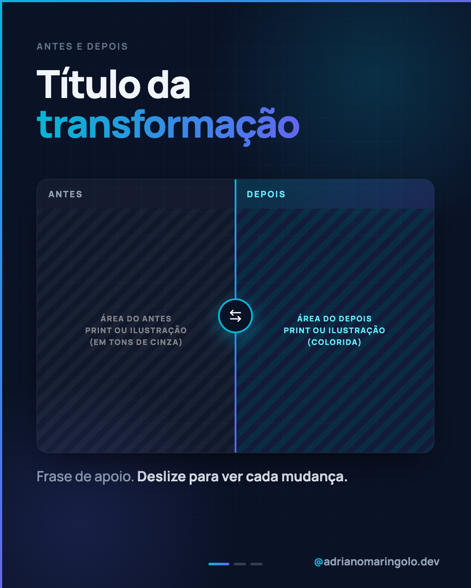
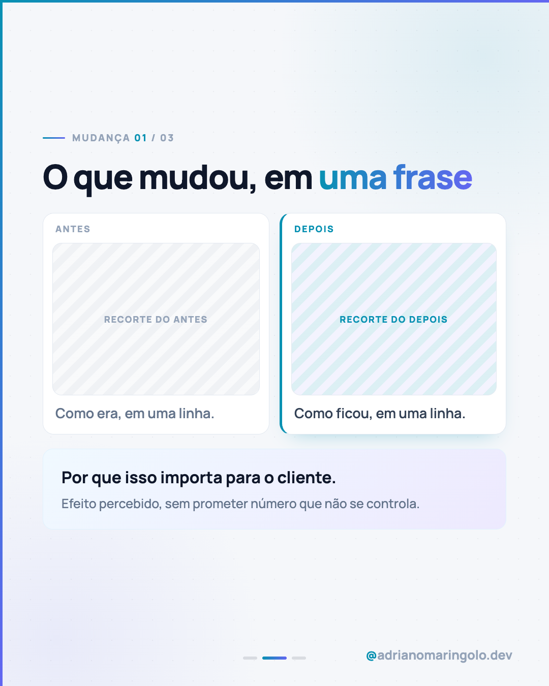

# Template `antes-depois`

> **Nível de criatividade:** 2 · Expressivo. Mesma fonte da marca, mas a composição foge do padrão (elemento central, foto em destaque, comparação). Efeito leve, sem fonte nova.

Uma **transformação mostrada lado a lado**. A capa é uma tela dividida ao meio, com divisor
em gradiente e um botão de troca no centro; o leitor vê o contraste antes de ler. Serve para
site, perfil, processo ou rotina: qualquer coisa que mude de um estado para outro.

---

## Preview

<table>
<tr><td width="32%"></td><td width="32%"></td><td width="32%"></td></tr>
<tr><td align="center"><b>Capa</b><br><sub>tela dividida antes × depois</sub></td><td align="center"><b>Interno</b><br><sub>dois recortes + por que importa</sub></td><td align="center"><b>Fecho</b><br><sub>resumo e convite</sub></td></tr>
</table>

Conteúdo placeholder. O HTML que gera estas imagens está em `previews/antes-depois/` — edite e rode
`node scripts/export-templates.mjs antes-depois` para regerar.

---

## Quando usar

- Redesign, correção de erro comum, mudança de processo, "como era / como ficou".
- Pilar 2 (prova e bastidores) e pilar 1 (educação, com exemplo fictício).
- Há **duas imagens comparáveis** (prints, ilustrações, telas simuladas) ou duas versões de um texto.

**Não use quando…** o foco é apresentar um projeto entregue de ponta a ponta: use
`case-showcase`, que mostra várias telas e o contexto. Se não há imagem do "antes", use
`tipografico` com comparativo.

---

## Estrutura de slides

| Slide | Papel | Tema |
|---|---|---|
| 01 | Capa: título + tela dividida (antes cinza, depois colorido) | Escuro `#0a1226` |
| 02 a N-1 | Uma mudança por slide: dois recortes lado a lado + "por que importa" | Claro `#f5f7fa` |
| N | Fecho: resumo do depois e convite | Escuro `#0f172a` |

Faixa: **4 a 7 slides**. Post único: só a capa, com a legenda explicando as mudanças.

---

## Capa

```css
.split  { display: grid; grid-template-columns: 1fr 1fr; border-radius: 26px; overflow: hidden; }
.half.before .hatch { filter: grayscale(1); opacity: .8; }       /* antes: sem cor */
.half.after  .half-tag { background: linear-gradient(135deg, rgba(6,182,212,.2), rgba(99,102,241,.2)); }
.divider { position: absolute; left: 50%; width: 4px; background: linear-gradient(180deg, #06b6d4, #6366f1); }
.knob    { width: 80px; height: 80px; border-radius: 50%; border: 4px solid #06b6d4; } /* ícone arrow-left-right */
```

Título no topo, tela dividida **centralizada na vertical** no espaço restante. O "antes"
sempre em tons de cinza; o "depois" mantém a cor e ganha o gradiente.

---

## Slides internos

Dois cartões lado a lado (`pair`): o "antes" neutro, o "depois" com borda esquerda cyan.
Cada um tem rótulo, recorte e uma linha de texto. Abaixo, o box **"por que importa"**
(gradiente leve) com o efeito para o cliente.

---

## Fecho

Escuro, com a síntese do "depois" no título e dois cartões "se… então…"
(`fecho-desfechos`). `fecho-recap` cabe quando as mudanças foram 3 ou mais.

---

## Imagens

Prints ou ilustrações, **dos dois lados com o mesmo enquadramento**. Nomes: `antes-01.png`,
`depois-01.png`… na pasta do post. Mínimo 1080 de largura para a capa. No preview, áreas
hachuradas com rótulo.

---

## Escala tipográfica

| Elemento | Tamanho | Peso |
|---|---|---|
| Headline de capa | 84–92px | 900 |
| Rótulo antes/depois | 20px | 800, uppercase |
| Headline interno | 60–66px | 900 |
| Texto do cartão | 26–28px | 600 |
| "Por que importa" | 30–32px / 25px | 700 / 500 |

---

## Variações permitidas

- Divisão vertical (padrão) ou horizontal (antes em cima, depois embaixo) quando as imagens são largas.
- Um recorte por slide interno (maior) ou dois cartões (padrão).
- "Antes" ilustrado em vez de print real.
- Slide extra de **métrica real** (com fonte), como o Lighthouse nos cases.
- Sem slide de fecho em post curto de 3 slides.
- `fecho-desfechos` ou `fecho-recap`.

## Travas

- **Antes em tons de cinza, depois colorido.** Razão: o contraste é a mensagem e precisa
  funcionar sem ler.
- **Mesmo enquadramento dos dois lados.** Razão: comparação justa, sem truque.
- **Só mostre "antes" que você pode mostrar** (próprio, fictício ou autorizado). Nunca o
  site de terceiros identificável. Razão: respeito e risco legal.
- **Nada de número ou ganho sem fonte ou sem medição.** Razão: regra de voz da marca.
- `background` escuro no `body`; `accent-left` + `accent-top`, progress dots e handle em todos os slides.
- Nenhum emoji no slide.

---

## Posts de referência

Nenhum ainda. Candidato imediato: o case ASM Marketing Digital (antes e depois do redesign), hoje pautado como `case-showcase`.
