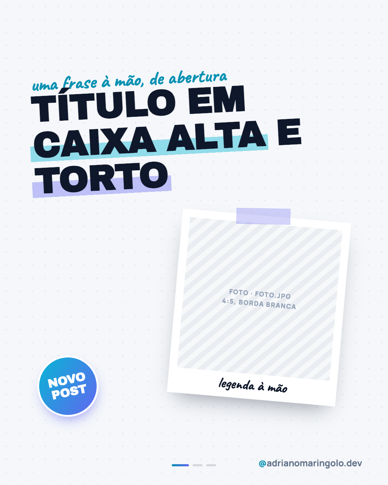
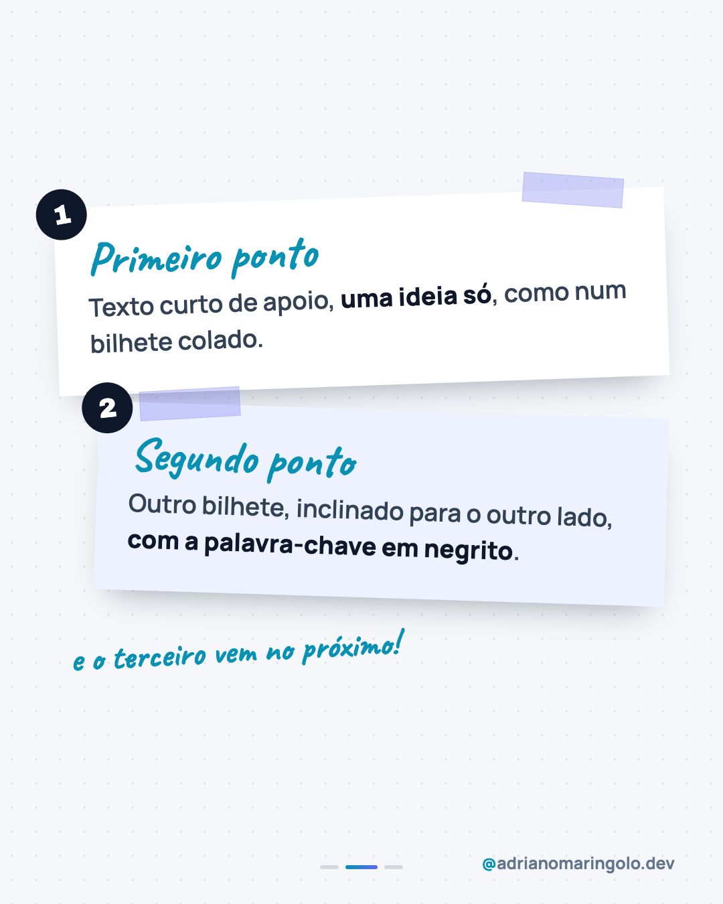

# Template `colagem-zine`

> **Nível de criatividade:** 3 · Ousado. Fonte de exibição própria e/ou efeito de texto ou de imagem. Exige a exceção de tipografia descrita neste template e respeita o teto de criatividade do cliente.

Estética de **colagem de zine**: título torto em caixa alta com marca-texto, polaroide
com fita, adesivo redondo, bilhetes inclinados e anotações à mão. É o formato mais
informal do feed: dica rápida, bastidor, o "olha só" do dono.

---

## Preview

<table>
<tr><td width="32%"></td><td width="32%"></td><td width="32%"></td></tr>
<tr><td align="center"><b>Capa</b><br><sub>título torto + polaroide + adesivo</sub></td><td align="center"><b>Interno</b><br><sub>bilhetes colados</sub></td><td align="center"><b>Fecho</b><br><sub>papel rasgado</sub></td></tr>
</table>

Conteúdo placeholder. O HTML que gera estas imagens está em `previews/colagem-zine/` — edite e rode
`node scripts/export-templates.mjs colagem-zine` para regerar.

---

## Quando usar

- Dicas rápidas, bastidores, novidades, "3 coisas que eu aprendi".
- Quando o post tem **foto de bastidor ou de rotina** e tom leve.
- Pilar 5 (humano) e pilar 2 (bastidores).

**Não use quando…** o assunto é sério, financeiro ou de decisão de contratação: o tom
brincalhão enfraquece a credibilidade. Aí, `tipografico` ou `revista-editorial`.

---

## Tipografia própria

> **Exceção de tipografia, só neste template.** O arquivo de marca manda em Manrope para tudo.
> Este template usa **Archivo Black** (títulos) e **Caveat** (anotações à mão) como fonte de exibição **apenas nos elementos listados abaixo**.
> O handle, o texto de apoio e o rodapé continuam em Manrope. Se a exceção virar regra do
> feed, formalize no manual (`/manual-marca manual`).

| Elemento | Fonte | Tamanho |
|---|---|---|
| Título (capa) | Archivo Black, uppercase | 96–110px, rotacionado −3° |
| Título (fecho) | Archivo Black | 80–90px |
| Anotação à mão | Caveat 700 | 52–68px |
| Legenda da polaroide | Caveat 700 | 40px |
| Texto do bilhete | Manrope 600 | 36–38px |
| Selo / numeração | Archivo Black | 34–40px |

```html
<link href="https://fonts.googleapis.com/css2?family=Archivo+Black&family=Caveat:wght@600;700&display=swap" rel="stylesheet">
```

---

## Efeitos

```css
.mark  { background: linear-gradient(transparent 52%, rgba(6,182,212,.42) 52%, rgba(6,182,212,.42) 92%, transparent 92%); }   /* marca-texto cyan */
.mark2 { background: linear-gradient(transparent 52%, rgba(99,102,241,.38) 52%, rgba(99,102,241,.38) 92%, transparent 92%); } /* marca-texto indigo */
.tape  { width: 150px; height: 44px; background: rgba(99,102,241,.28); }                     /* fita translúcida */
.polaroid { background: #fff; padding: 22px 22px 70px; transform: rotate(5deg); box-shadow: 0 30px 60px -26px rgba(15,23,42,.45); }
.sticker  { border-radius: 50%; background: linear-gradient(135deg, #06b6d4, #6366f1); border: 5px solid #fff; transform: rotate(-12deg); }
.torn  { clip-path: polygon(0 2%, 8% 0, 17% 2%, 28% 0, …, 0 98%); transform: rotate(-2deg); }  /* papel rasgado */
```

Só cores da marca: marca-texto em cyan e indigo, nunca amarelo.

---

## Estrutura de slides

| Slide | Papel | Tema |
|---|---|---|
| 01 | Capa: anotação, título torto, polaroide com foto, adesivo | Claro `#f5f7fa` com pontilhado |
| 02 a N-1 | Um bilhete por ponto (2 por slide), inclinados em sentidos opostos | Claro |
| N | Fecho: anotação + papel rasgado com a chamada e a URL | Escuro `#0f172a` |

Faixa: **3 a 6 slides**.

---

## Capa

Bloco central **centralizado na vertical**: anotação à mão acima, título torto com um trecho
em marca-texto cyan e outro em indigo, polaroide com fita à direita e o adesivo ("Novo post",
"Dica", "Bastidor") no canto inferior esquerdo, fora do título.

## Slides internos

Bilhetes brancos (`#fff`) e azulados (`#eef2ff`), inclinados ±2°, com fita, **número num círculo
preto** colado no canto, título em Caveat e texto em Manrope. Uma anotação final à mão avisa
que tem mais.

## Fecho

Fundo escuro com pontilhado claro, anotação à mão em cyan claro e **papel rasgado** branco com a
chamada em Archivo Black (um trecho em marca-texto) e a URL em gradiente. Dots claros.

---

## Imagens

A polaroide recebe `foto.jpg` em 4:5 com borda branca, **sem filtro** (cores reais). Se a
foto for escura, aplique brilho antes. Sem foto, troque a polaroide por um adesivo grande.

---

## Variações permitidas

- Polaroide à direita (padrão), à esquerda ou duas polaroides sobrepostas.
- Marca-texto em cyan, indigo ou os dois.
- Adesivo com texto diferente ou ausente.
- Bilhetes: 1, 2 ou 3 por slide, conforme o texto.
- Fita em indigo ou cyan translúcido.
- Fecho em papel claro, com o texto escuro, ou o inverso.

## Travas

- **No máximo 2 fontes de exibição (Archivo Black + Caveat) e Manrope no texto corrido.** Razão: colagem é bagunça controlada; fonte demais vira ruído.
- **Caveat só em anotações curtas (até 6 palavras).** Razão: manuscrita não se lê em parágrafo.
- **Rotação entre −6° e +6°.** Razão: mais que isso vira erro, não estilo.
- **Nada de cor fora da paleta** (marca-texto, fita, adesivo só em cyan, indigo e neutros).
- **Texto do bilhete sempre em Manrope sobre fundo claro**, com contraste AA.
- `background` escuro no `body` do fecho; handle e progress dots em todos os slides; sem emoji no slide.

---

## Posts de referência

Nenhum ainda. Candidato: `post-57` (Dia das Crianças) e posts de rotina e carreira.
