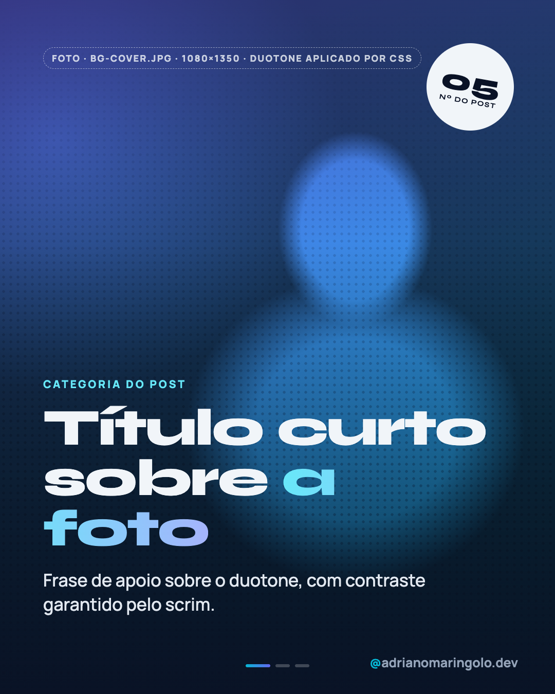
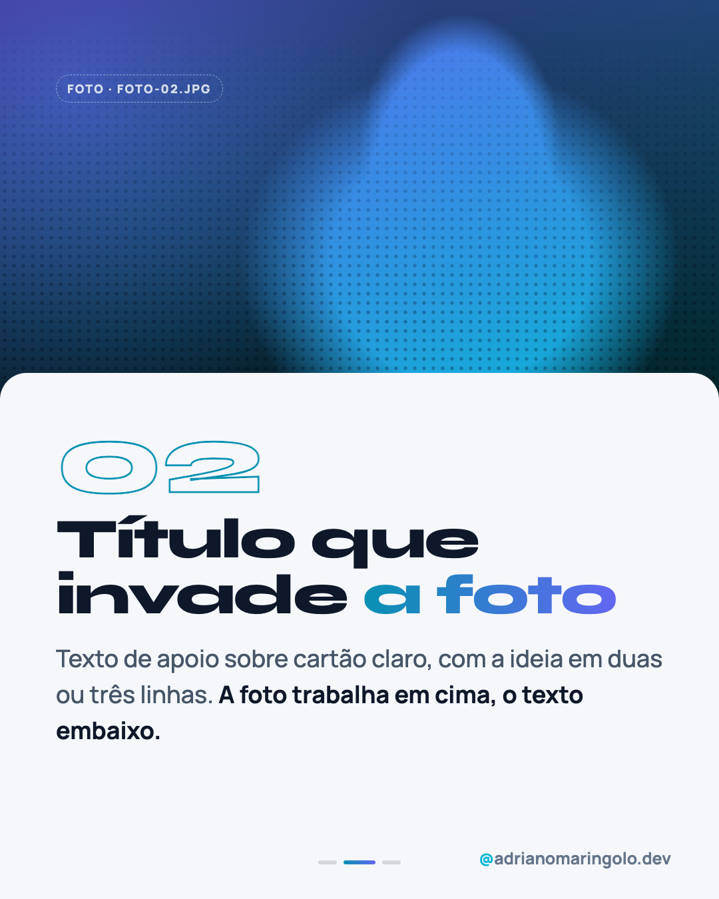
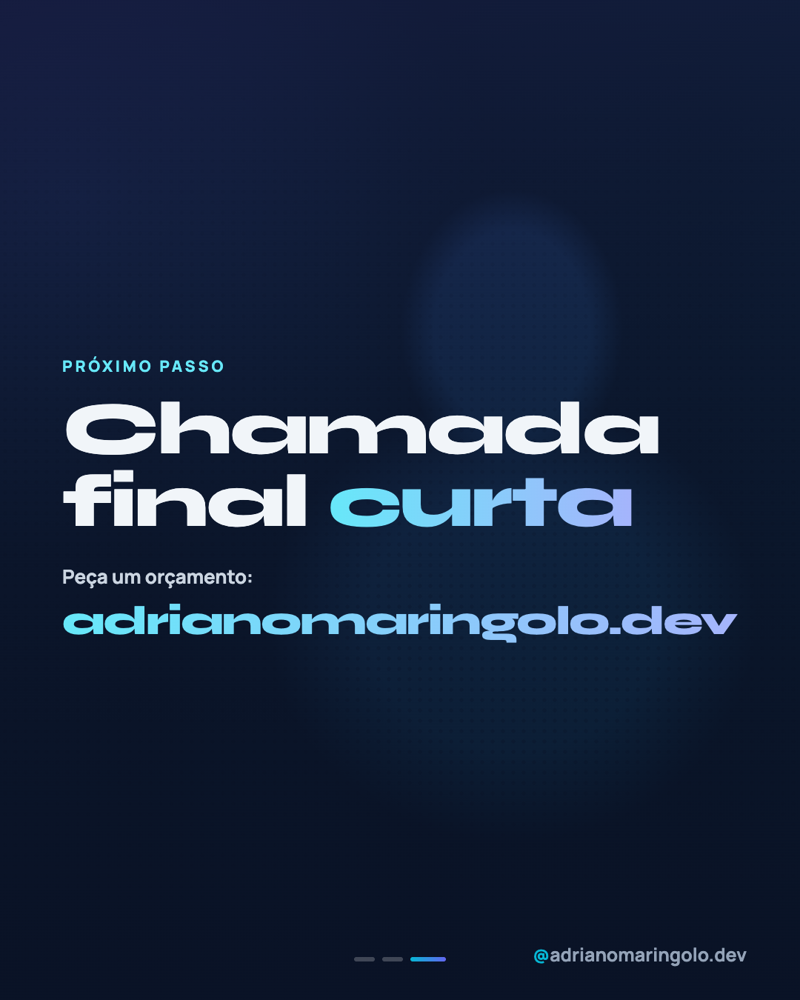

# Template `duotone-foto`

> **Nível de criatividade:** 3 · Ousado. Fonte de exibição própria e/ou efeito de texto ou de imagem. Exige a exceção de tipografia descrita neste template e respeita o teto de criatividade do cliente.

A foto vira **identidade visual**: preto e branco mapeado em navy → cyan/indigo (duotone),
com trama de pontos de meio-tom e um selo redondo girado. O título em fonte larga e pesada
fica sobre a foto. Qualquer foto, de qualquer origem, passa a parecer da marca.

---

## Preview

<table>
<tr><td width="32%"></td><td width="32%"></td><td width="32%"></td></tr>
<tr><td align="center"><b>Capa</b><br><sub>foto em duotone + título</sub></td><td align="center"><b>Interno</b><br><sub>foto no topo, cartão claro</sub></td><td align="center"><b>Fecho</b><br><sub>foto esmaecida + chamada</sub></td></tr>
</table>

Conteúdo placeholder. O HTML que gera estas imagens está em `previews/duotone-foto/` — edite e rode
`node scripts/export-templates.mjs duotone-foto` para regerar.

---

## Quando usar

- Foto com pessoa, ambiente ou objeto que **não combina sozinha com a paleta** (Pexels, fotos de celular).
- Posts em que o clima importa mais que a explicação.
- Pilares 5 (humano), 1 (educação com foto) e datas comemorativas.

**Não use quando…** a foto precisa mostrar cor real (produto, case, retrato do dono): use
`foto-editorial` ou `foto-protagonista`. Tela de projeto fica em `case-showcase`.

---

## Tipografia própria

> **Exceção de tipografia, só neste template.** O arquivo de marca manda em Manrope para tudo.
> Este template usa **Syne** (larga e pesada) como fonte de exibição **apenas nos elementos listados abaixo**.
> O handle, o texto de apoio e o rodapé continuam em Manrope. Se a exceção virar regra do
> feed, formalize no manual (`/manual-marca manual`).

| Elemento | Fonte | Tamanho | Peso |
|---|---|---|---|
| Título (capa) | Syne | 96–116px | 800, `letter-spacing: -0.03em` |
| Título (interno) | Syne | 76–84px | 800 |
| Numeral | Syne, só contorno | 150px | 800 |
| Selo | Syne | 56px / 14px | 800 / 700 |
| Eyebrow, apoio, rótulos | Manrope | 21px / 34–36px | 800 / 500 |

```html
<link href="https://fonts.googleapis.com/css2?family=Syne:wght@600;700;800&display=swap" rel="stylesheet">
```

---

## Efeito de imagem: duotone por CSS

Sem editar a foto: o arquivo original (colorido ou P&B) vira duotone na renderização. A foto
fica dentro de `.duo`, e duas camadas de mistura criam o mapa navy → cyan → indigo.

```css
.duo { position: absolute; inset: 0; overflow: hidden; isolation: isolate; }
.duo img, .duo .photo { filter: grayscale(1) contrast(1.1) brightness(1.2); }
.duo::before { content: ''; position: absolute; inset: 0; background: #0a1226; mix-blend-mode: lighten; z-index: 2; }  /* sombras viram navy */
.duo::after  { content: ''; position: absolute; inset: 0; background: linear-gradient(160deg, #6366f1, #06b6d4); mix-blend-mode: multiply; z-index: 3; } /* luzes viram cyan */
.halftone { background-image: radial-gradient(circle, rgba(10,18,38,.55) 2.4px, transparent 3px); background-size: 14px 14px;
            mix-blend-mode: multiply; opacity: .55; mask-image: linear-gradient(180deg, transparent, #000 75%); }
.scrim { background: linear-gradient(180deg, rgba(10,18,38,.15), rgba(10,18,38,0) 35%, rgba(10,18,38,.92)); }
```

No preview, a foto é um placeholder em tons de cinza (silhueta) para mostrar o efeito.

---

## Estrutura de slides

| Slide | Papel | Tema |
|---|---|---|
| 01 | Capa: foto em duotone em tela cheia, selo girado, título embaixo | Escuro |
| 02 a N-1 | Foto em duotone no topo (≈ 45%), cartão claro com cantos arredondados invadindo a foto | Claro `#f5f7fa` no cartão |
| N | Fecho: mesma foto esmaecida (50%) + scrim + chamada + URL | Escuro |

Faixa: **3 a 6 slides**. Post único: só a capa.

---

## Capa

Foto em tela cheia (`bg-cover.jpg`), trama de meio-tom na metade de baixo, scrim para o texto,
selo redondo girado a 10° (número do post) no canto superior direito, eyebrow cyan claro
`#67e8f9`, título (palavra final em gradiente claro `#67e8f9 → #a5b4fc`) e apoio em Manrope.

## Slides internos

Cartão `#f5f7fa` com cantos de 40px sobe até a foto (`top: 560px`). Numeral em contorno,
título em Syne 84px com palavra em gradiente, texto em Manrope 36px. **Dots escuros** sobre o cartão claro.

## Fecho

Foto repetida a 50%, scrim forte, eyebrow, chamada em Syne e URL em Syne com gradiente claro
(54px: a fonte é larga, então a URL precisa de tamanho menor para não cortar).

---

## Imagens

Foto própria > Pexels (regra do arquivo de marca). `bg-cover.jpg` na capa e no fecho, `foto-02.jpg`
etc. nos internos. Mínimo 1080×1350 (ideal 1620×2025). Funciona melhor com foto de **alto
contraste e sujeito claro**. Fotos escuras demais viram um bloco navy.

---

## Variações permitidas

- Gradiente do duotone: navy→cyan (padrão) ou navy→indigo.
- Meio-tom presente ou ausente.
- Selo redondo (padrão), carimbo retangular ou nenhum.
- Slide interno com foto em tela cheia e título embaixo (como a capa).
- Foto diferente em cada slide, ou a mesma recortada em enquadramentos distintos.
- Título em 2 a 4 linhas.

## Travas

- **Toda foto passa pelo duotone.** Razão: é o que unifica fotos de origens diferentes. Foto colorida ao lado de duotone quebra o feed.
- **Scrim sempre sob o texto da capa.** Razão: contraste AA sobre foto.
- **Syne só no título e no selo.** Razão: fonte larga cansa em texto corrido.
- **URL do fecho com no máximo 56px.** Razão: Syne é larga e corta em 1080px.
- **Foto com direito de uso**, com crédito em `meta.json` se for Pexels.
- `background` escuro no `body`; handle e progress dots em todos os slides (dots escuros no cartão claro); sem emoji no slide.

---

## Posts de referência

Nenhum ainda. Candidatos: `post-54` (foto Pexels na capa) e `post-57` (Dia das Crianças), que hoje usam fotos coloridas.
