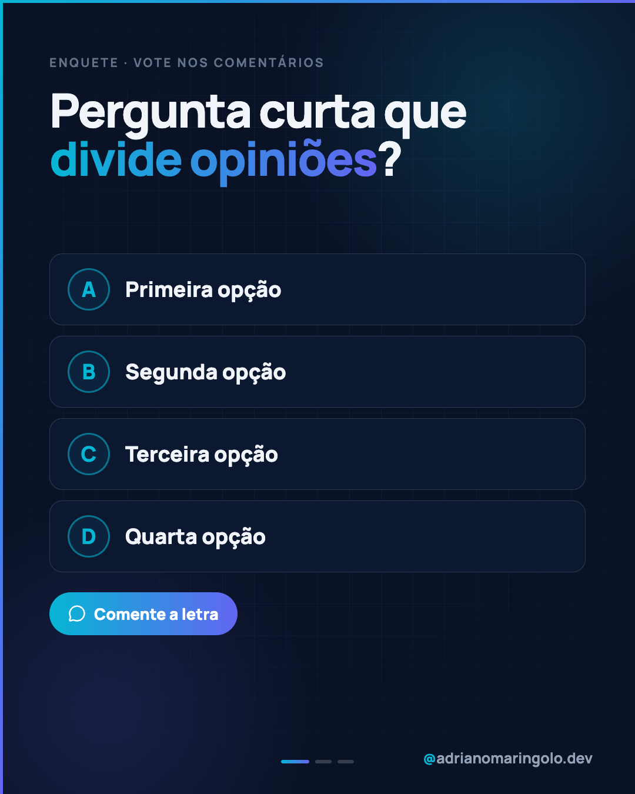

# Template `enquete-votacao`

> **Nível de criatividade:** 1 · Base. Só Manrope, esqueleto previsível, sem efeito de texto ou de imagem. Cabe em qualquer cliente e é a base do feed.

Uma **pergunta com opções A, B, C, D** para o público votar nos comentários, e um slide de
revelação com a resposta. O objetivo é comentário e salvamento, não explicação. Dá estrutura
ao que os posts `post-44` (enquete) e `post-45` (mito ou verdade) faziam de forma avulsa.

---

## Preview

<table>
<tr><td width="32%"></td><td width="32%"></td><td width="32%"></td></tr>
<tr><td align="center"><b>Capa</b><br><sub>pergunta + opções A–D</sub></td><td align="center"><b>Revelação</b><br><sub>a correta em gradiente</sub></td><td align="center"><b>Fecho</b><br><sub>qual letra você votou</sub></td></tr>
</table>

Conteúdo placeholder. O HTML que gera estas imagens está em `previews/enquete-votacao/` — edite e rode
`node scripts/export-templates.mjs enquete-votacao` para regerar.

---

## Quando usar

- Enquete ("seu negócio tem site hoje?"), "mito ou verdade", quiz de uma pergunta.
- Pilar de **engajamento**. Costuma abrir ou fechar a semana.
- Pergunta com 2 a 4 opções e uma **resposta que dá para defender**.

**Não use quando…** não existe resposta certa nem revelação e o post é só uma pergunta
aberta: use `frase-unica`. Se a resposta precisa de desenvolvimento, use `tipografico`.

---

## Estrutura de slides

| Slide | Papel | Tema |
|---|---|---|
| 01 | Capa: pergunta + 4 opções A–D + chamada "Comente a letra" | Escuro `#0a1226` |
| 02 | Revelação: opções esmaecidas, a correta em gradiente, "por que" | Claro `#f5f7fa` |
| 03 | Fecho: "qual letra você votou?" + convite | Escuro `#0f172a` |

Faixa: **3 a 5 slides**. Em "mito ou verdade" com várias frases, repita o par pergunta/revelação.

---

## Capa

Título (80px) com `<em>` em gradiente no trecho que divide opiniões e `?` no fim. Opções em
cartões escuros (`#0c1730`) com **letra em círculo** (cyan, 72px) e o texto a 36px. Abaixo,
a pílula em gradiente **Comente a letra**. Título no topo, opções e pílula **centralizadas
na vertical** no espaço restante.

```css
.letter { width: 72px; height: 72px; border-radius: 50%; border: 3px solid rgba(6,182,212,.55);
          font-size: 36px; font-weight: 900; color: #06b6d4; }
.vote   { background: linear-gradient(90deg, #06b6d4, #6366f1); border-radius: 100px; }
```

---

## Slides internos

**Revelação**: as mesmas opções, as erradas a 60% de opacidade, a correta em gradiente com a
etiqueta **Resposta**. Abaixo, o box "por que" (uma frase + o efeito prático). Sem número de
votos: o resultado real da enquete só aparece num post futuro, com o dado verdadeiro.

---

## Fecho

Escuro, título "Qual letra você votou?" e dois cartões "se… então…": quem acertou
(convite a marcar alguém) e quem errou (convite ao orçamento). A venda é leve, só no
segundo cartão.

---

## Imagens

Nenhuma. Ícones Lucide (`message-circle`, `vote`), path real.

---

## Escala tipográfica

| Elemento | Tamanho | Peso |
|---|---|---|
| Pergunta (capa) | 76–84px | 900 |
| Opção | 34–38px | 800 |
| Letra | 34–38px | 900 |
| Título da revelação | 62–68px | 900 |
| "Por que" | 30–32px / 25px | 700 / 500 |

---

## Variações permitidas

- 2, 3 ou 4 opções (A/B, A/B/C, A–D).
- **Mito ou verdade**: opções viram "Mito" e "Verdade", com a frase no lugar da pergunta.
- Opção com descrição curta embaixo do título.
- Revelação com mais de um slide (um por opção, quando cada uma tem explicação).
- Capa clara quando a pergunta é leve ou comemorativa.
- Sem slide de fecho (post de 2 slides).

## Travas

- **Uma resposta defensável.** Razão: sem isso a revelação vira opinião disfarçada de fato.
- **Nunca exiba percentuais de votos inventados.** Razão: número sem fonte é proibido pela voz da marca.
- **Letras sempre em círculo, na mesma posição.** Razão: a mecânica de votar tem que ser óbvia em meio segundo.
- **A chamada "Comente a letra" aparece na capa.** Razão: é a ação que o post pede.
- Opção errada esmaecida, nunca riscada nem humilhante. Razão: tom da marca, sem guru.
- `background` escuro no `body`; `accent-left` + `accent-top`, progress dots e handle em todos os slides; sem emoji no slide.

---

## Posts de referência

`post-44` (enquete: seu negócio tem site hoje?) e `post-45` (mito ou verdade), hoje
classificados em outros templates.
