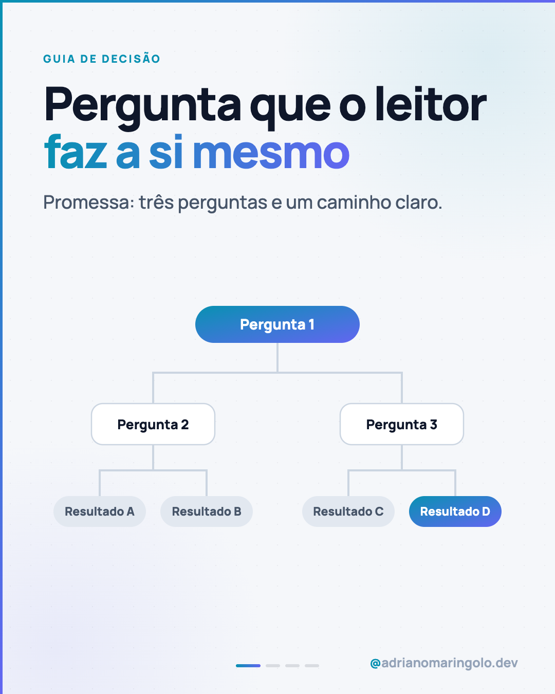
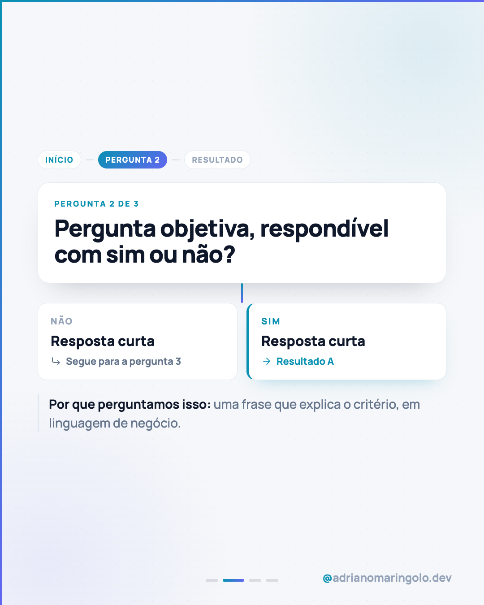

# Template `fluxograma-decisao`

> **Nível de criatividade:** 1 · Base. Só Manrope, esqueleto previsível, sem efeito de texto ou de imagem. Cabe em qualquer cliente e é a base do feed.

Um **guia de decisão**: o leitor responde a perguntas simples e chega a uma recomendação.
A capa mostra a árvore inteira (uma pergunta, ramos, resultados); cada slide interno é um nó.
Ajuda quem não sabe o que pedir, uma dor central do público.

---

## Preview

<table>
<tr><td width="24%"></td><td width="24%"></td><td width="24%"></td><td width="24%"></td></tr>
<tr><td align="center"><b>Capa</b> pergunta + árvore de decisão</td><td align="center"><b>Interno</b> um nó: pergunta e respostas</td><td align="center"><b>Resultado</b> recomendação e alternativa</td><td align="center"><b>Fecho</b> oferta</td></tr>
</table>

Conteúdo placeholder. O HTML que gera estas imagens está em `previews/fluxograma-decisao/` — edite e rode
`node scripts/export-templates.mjs fluxograma-decisao` para regerar.

---

## Quando usar

- "Qual tipo de site eu preciso?", "site próprio ou construtor?", "vale refazer o site?".
- Pilar 1 (educação para o cliente). Há **2 a 4 caminhos** possíveis e critérios claros.
- Quando a resposta honesta é "depende", e você sabe de quê.

**Não use quando…** o conteúdo explica um mecanismo (use `explicador-tecnico`) ou apenas
compara duas opções sem ramificação (use `tipografico` com comparativo).

---

## Estrutura de slides

| Slide | Papel | Tema |
|---|---|---|
| 01 | Capa: pergunta-título + mini árvore de decisão | **Claro** `#f5f7fa` |
| 02 a N-2 | Um nó por slide: pergunta, duas respostas, para onde cada uma leva | Claro |
| N-1 | Resultado: recomendação principal + alternativa | Claro |
| N | Fecho: "me conte o seu caso" | Escuro `#0f172a` |

Faixa: **5 a 8 slides**. Máximo de 3 perguntas em sequência, para a árvore caber na capa.

---

## Capa

Clara, com a árvore em SVG (nós em pílula e cartões, ligações em `#cbd5e1`). O nó raiz e um
dos resultados usam o gradiente; os demais ficam neutros. Eyebrow cyan (`Guia de decisão`),
headline de 90px com `<em>` em gradiente e uma linha de promessa. A árvore fica
**centralizada na vertical** no espaço abaixo do texto.

---

## Slides internos

- **Trilha** no topo: `Início → Pergunta 2 → Resultado`, com o passo atual em gradiente.
- **Cartão da pergunta** grande (52px) com `Pergunta 2 de 3`.
- **Haste** em gradiente ligando a pergunta às duas respostas.
- **Duas respostas** lado a lado (`Não` neutro, `Sim` com borda cyan) e, em cada uma, para onde ela leva.
- **Nota**: "Por que perguntamos isso", com o critério em linguagem de negócio.

---

## Fecho

Escuro com `fecho-desfechos`: "se o resultado serviu" / "se nenhum serviu, me conte o seu
caso". É um fecho de oferta, então conta como venda direta no mix do feed.

---

## Imagens

Nenhuma. Árvore em SVG e cartões em HTML/CSS. Ícones Lucide (`arrow-right`,
`corner-down-right`, `list-checks`, `message-circle`), path real.

---

## Escala tipográfica

| Elemento | Tamanho | Peso |
|---|---|---|
| Headline de capa | 86–92px | 900 |
| Pergunta (cartão) | 48–54px | 900 |
| Resposta (título) | 30–32px | 800 |
| Rótulo / trilha | 17–20px | 800, uppercase |
| Resultado (título) | 38–42px | 900 |

---

## Variações permitidas

- 2 ou 3 níveis de perguntas, e 3 ou 4 resultados.
- Respostas **Sim/Não** (padrão) ou com 3 opções, quando a pergunta não é binária.
- Slide de resultado único (para um post "se você chegou aqui") ou um slide por resultado.
- Árvore horizontal na capa quando há 4 resultados.
- Slide de "como usar este guia" logo após a capa.
- Fecho `fecho-desfechos` ou `fecho-recap`.

## Travas

- **Toda pergunta responde com sim ou não, ou com até 3 opções objetivas.** Razão: se
  precisa explicar a pergunta, ela não é critério.
- **Todo caminho termina em um resultado.** Sem beco sem saída. Razão: o guia só vale se resolve.
- **A recomendação é honesta**, inclusive quando é "não precisa de mim". Razão: honestidade técnica é diferencial da marca.
- **Sem preço em R$ nos resultados.** Razão: regra da marca (explicar fatores, não valores).
- A capa é clara, como no `tipografico`; o fecho é sempre escuro. Razão: capa de leitura, fecho de oferta.
- `accent-left` + `accent-top`, progress dots e handle em todos os slides; sem emoji no slide.

---

## Posts de referência

Nenhum ainda. Candidatos: "Que tipo de site o seu negócio precisa?" (`post-10`) e "Wix ou
site sob medida?" (`post-41`), hoje em `tipografico`.
