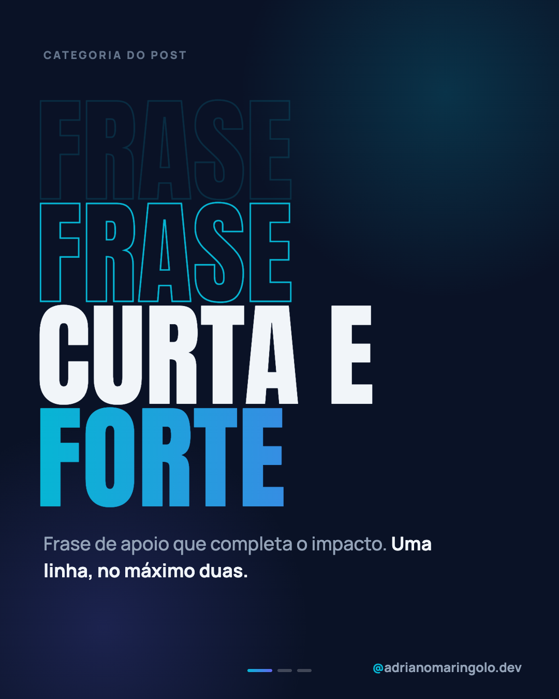
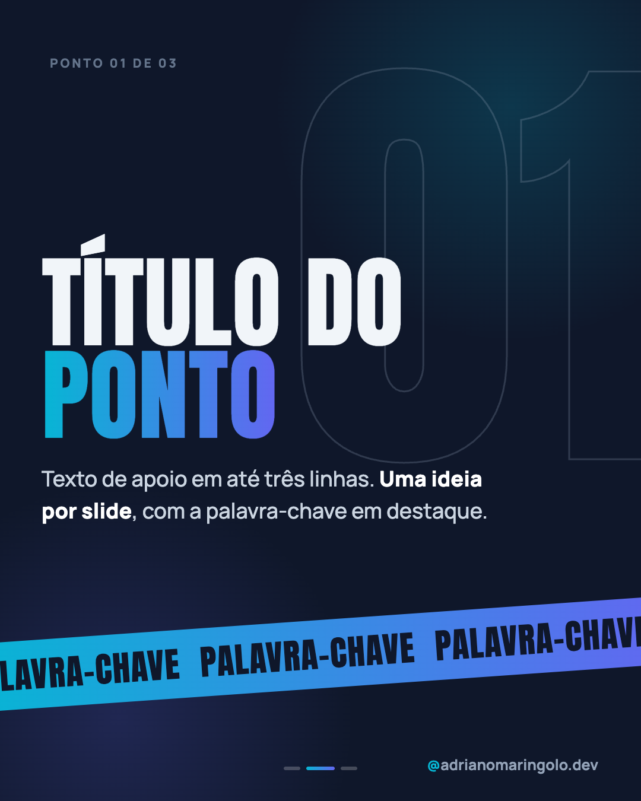
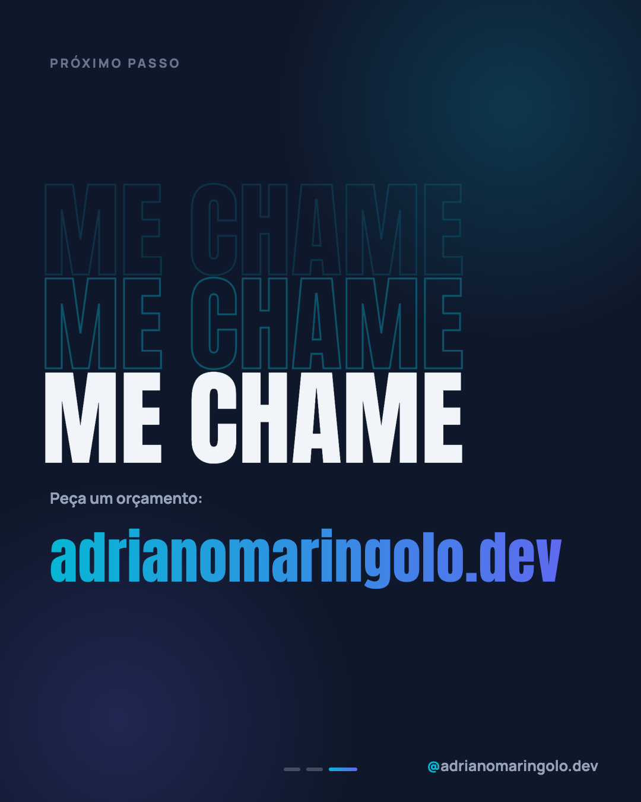

# Template `outline-impacto`

> **Nível de criatividade:** 3 · Ousado. Fonte de exibição própria e/ou efeito de texto ou de imagem. Exige a exceção de tipografia descrita neste template e respeita o teto de criatividade do cliente.

**Tipografia como imagem**: palavras gigantes em fonte condensada, alternando contorno, sólido
e gradiente, com **eco** de contorno que some. Em cada slide interno, um numeral gigante em
contorno atrás do título e uma faixa inclinada com palavra-chave repetida. É o formato mais
barulhento do feed: poucas palavras, volume máximo.

---

## Preview

<table>
<tr><td width="32%"></td><td width="32%"></td><td width="32%"></td></tr>
<tr><td align="center"><b>Capa</b><br><sub>palavras em contorno, sólido e gradiente</sub></td><td align="center"><b>Interno</b><br><sub>numeral em contorno + faixa</sub></td><td align="center"><b>Fecho</b><br><sub>eco de "me chame"</sub></td></tr>
</table>

Conteúdo placeholder. O HTML que gera estas imagens está em `previews/outline-impacto/` — edite e rode
`node scripts/export-templates.mjs outline-impacto` para regerar.

---

## Quando usar

- Provocação, chamada, afirmação curta ("Site não é gasto"), lançamento, aviso.
- Posts de 3 a 6 slides com **uma ideia por slide** e texto mínimo.
- Pilar 1 (educação, em formato de manifesto) e 5 (opinião).

**Não use quando…** o conteúdo precisa de explicação longa: use `tipografico`. Para uma frase
única sem sequência, `frase-unica` é mais limpo.

---

## Tipografia própria

> **Exceção de tipografia, só neste template.** O arquivo de marca manda em Manrope para tudo.
> Este template usa **Anton** (condensada, caixa alta) como fonte de exibição **apenas nos elementos listados abaixo**.
> O handle, o texto de apoio e o rodapé continuam em Manrope. Se a exceção virar regra do
> feed, formalize no manual (`/manual-marca manual`).

| Elemento | Fonte | Tamanho |
|---|---|---|
| Palavras da capa | Anton, uppercase | 210–240px, `line-height: .9` |
| Título interno | Anton, uppercase | 150–180px |
| Numeral de fundo | Anton | 700–780px, só contorno |
| Faixa de palavra-chave | Anton, uppercase | 54–60px |
| URL do fecho | Anton | 90–100px |
| Subtítulo, corpo, eyebrow | Manrope | 34–36px / 21px |

```html
<link href="https://fonts.googleapis.com/css2?family=Anton&display=swap" rel="stylesheet">
```

---

## Estrutura de slides

| Slide | Papel | Tema |
|---|---|---|
| 01 | Capa: 3 palavras em camadas (eco, contorno, sólido, gradiente) + apoio | Escuro `#0a1226` |
| 02 a N-1 | Um ponto: numeral em contorno, título curto, 1 a 2 linhas, faixa | Escuro `#0f172a` |
| N | Fecho: "Me chame" em eco + URL | Escuro `#0f172a` |

Faixa: **3 a 6 slides**.

---

## Efeitos de texto

```css
.out  { color: transparent; -webkit-text-stroke: 3px #06b6d4; }                 /* contorno */
.ech1 { color: transparent; -webkit-text-stroke: 3px rgba(6,182,212,0.38); }    /* eco 1 */
.ech2 { color: transparent; -webkit-text-stroke: 3px rgba(6,182,212,0.16); }    /* eco 2 */
.solid { color: #f1f5f9; }
.g { background: linear-gradient(90deg, #06b6d4, #6366f1); -webkit-background-clip: text; -webkit-text-fill-color: transparent; }
.band { transform: rotate(-4deg); background: linear-gradient(90deg, #06b6d4, #6366f1); }
```

---

## Capa

Eyebrow no topo e um bloco de palavras **centralizado na vertical** (`.mid`). Ordem dos
tons: eco fraco, contorno, sólido branco, gradiente. A palavra de maior peso vai no sólido;
o final da frase, no gradiente. Linha de apoio em Manrope embaixo.

## Slides internos

Numeral (`01`) em contorno cinza `rgba(148,163,184,.25)`, cortado pela borda direita de
propósito. Título em 2 linhas (a segunda em gradiente), texto curto e a **faixa inclinada**
repetindo a palavra-chave (o texto da faixa passa da borda, para sugerir movimento).

## Fecho

Três linhas da mesma chamada (eco 2, eco 1, sólido), rótulo `Peça um orçamento:` e a URL em
Anton com gradiente.

---

## Imagens

Nenhuma. O texto é a imagem.

---

## Variações permitidas

- Tom do contorno: cyan (padrão) ou indigo.
- 2 a 4 camadas de eco, no capa e no fecho.
- Faixa inclinada para a esquerda (`-4deg`) ou direita (`4deg`).
- Numeral de fundo à direita (padrão) ou à esquerda.
- Palavra única gigante em vez de três.
- Slide interno sem faixa quando o texto é mais longo.

## Travas

- **Máximo de 6 palavras por slide em Anton.** Razão: condensada em caixa alta cansa; o efeito vem do vazio ao redor.
- **Texto de apoio sempre em Manrope.** Razão: legibilidade e identidade.
- **Contorno nunca em corpo de texto.** Razão: contorno só é legível em corpo grande.
- **Contraste AA no que for informação** (sólido e gradiente); o eco é decoração.
- **Um único gradiente por slide.** Razão: gradiente é pontual.
- Fundo escuro declarado no `body`; handle e progress dots em todos os slides; sem emoji no slide.

---

## Posts de referência

`post-59` (sob medida não é luxo, carrossel de 5 slides). Semente conceitual: `post-46`, em `frase-unica`.
