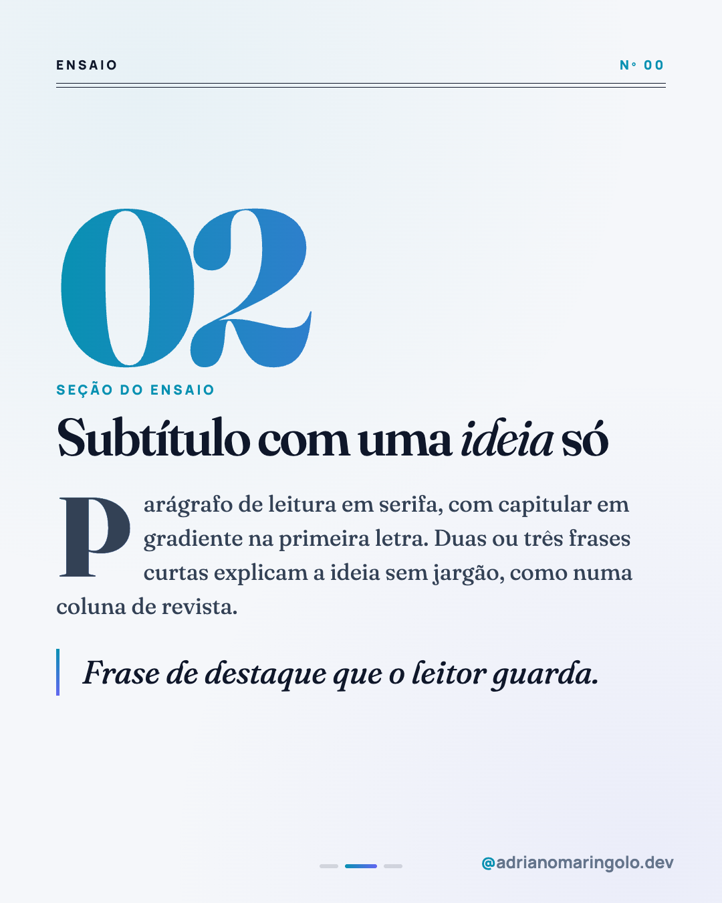
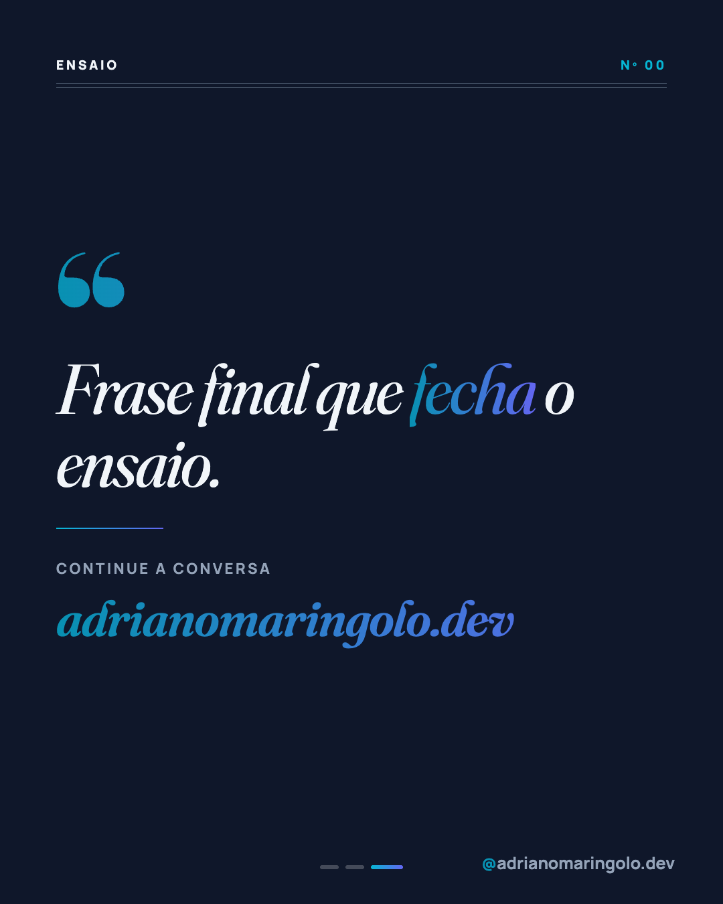

# Template `revista-editorial`

> **Nível de criatividade:** 3 · Ousado. Fonte de exibição própria e/ou efeito de texto ou de imagem. Exige a exceção de tipografia descrita neste template e respeita o teto de criatividade do cliente.

Aparência de **ensaio de revista**: serifa de alto contraste, itálico em gradiente, filetes
duplos, numeral gigante e capitular. Leitura lenta e opinativa, no polo oposto do feed "tech".
Cabe no pilar humano e em opiniões que merecem peso.

---

## Preview

<table>
<tr><td width="32%"></td><td width="32%"></td><td width="32%"></td></tr>
<tr><td align="center"><b>Capa</b><br><sub>manchete em serifa + linha fina</sub></td><td align="center"><b>Interno</b><br><sub>numeral, capitular, citação</sub></td><td align="center"><b>Fecho</b><br><sub>frase final em itálico</sub></td></tr>
</table>

Conteúdo placeholder. O HTML que gera estas imagens está em `previews/revista-editorial/` — edite e rode
`node scripts/export-templates.mjs revista-editorial` para regerar.

---

## Quando usar

- Opinião, carreira, valores, bastidor reflexivo ("o que aprendi em 17 anos").
- Pilares 5 (humano e opinião) e 4 (autoridade), quando o tema pede tom de coluna.
- Texto com **parágrafos de verdade** (2 a 3 frases por slide), não só tópicos.

**Não use quando…** o conteúdo é lista rápida ou técnico: use `tipografico`. Para uma frase
só, use `frase-unica`.

---

## Tipografia própria

> **Exceção de tipografia, só neste template.** O arquivo de marca manda em Manrope para tudo.
> Este template usa **Fraunces** (serifa variável) como fonte de exibição **apenas nos elementos listados abaixo**.
> O handle, o texto de apoio e o rodapé continuam em Manrope. Se a exceção virar regra do
> feed, formalize no manual (`/manual-marca manual`).

| Elemento | Fonte | Tamanho | Peso |
|---|---|---|---|
| Manchete (capa) | Fraunces | 128–144px | 800, `letter-spacing: -0.035em`; palavra de ênfase em *itálico 400* com gradiente |
| Abertura, linha fina | Fraunces itálico | 38–42px | 400 |
| Numeral de seção | Fraunces | 300–340px | 800, gradiente |
| Subtítulo | Fraunces | 72–80px | 600 |
| Corpo | Fraunces | 33–35px | 400, `line-height: 1.5` |
| Citação de destaque | Fraunces itálico | 46–50px | 400 |
| Faixa de cabeçalho / rótulos | Manrope | 19–20px | 800, uppercase, `letter-spacing: .2em` |

```html
<link href="https://fonts.googleapis.com/css2?family=Fraunces:ital,opsz,wght@0,9..144,400;0,9..144,600;0,9..144,800;1,9..144,400;1,9..144,600&display=swap" rel="stylesheet">
```

---

## Estrutura de slides

| Slide | Papel | Tema |
|---|---|---|
| 01 | Capa: cabeçalho de revista, manchete, linha fina, assinatura | Claro com papel `#f5f7fa` |
| 02 a N-1 | Seção: numeral gigante, subtítulo, parágrafo com capitular, citação | Claro |
| N | Fecho: aspas + frase final em itálico + URL | Escuro `#0f172a` |

Faixa: **5 a 8 slides**.

---

## Capa

Cabeçalho (`Ensaio · Nº 00`) com **filete duplo** (duas linhas de 1,5px), bloco central
(abertura em itálico cyan, manchete, linha fina com filete cinza em cima) e rodapé com
`Por Adriano Maringolo` e a contagem de slides, sobre filete simples. O bloco central é
**centralizado na vertical** (`.mid { flex: 1; justify-content: center }`).

```css
.mast { border-bottom: 1.5px solid #0f172a; position: relative; }
.mast::after { content: ''; position: absolute; left: 0; right: 0; bottom: -7px; height: 1.5px; background: #0f172a; }
.h1 i { font-weight: 400; font-style: italic; }   /* palavra de ênfase, com .g */
```

---

## Slides internos

Numeral da seção em gradiente (`02`), rótulo, subtítulo com uma palavra em itálico, parágrafo
com **capitular** (`::first-letter`, 160–170px, gradiente) e, opcionalmente, uma **citação**
com filete lateral em gradiente.

```css
.body::first-letter { float: left; font-weight: 800; font-size: 168px; line-height: .78;
  background: linear-gradient(135deg, #0891b2, #6366f1); -webkit-background-clip: text; -webkit-text-fill-color: transparent; }
```

---

## Fecho

Escuro. Aspas de abertura em gradiente (Fraunces 800, ~260px), a frase final em itálico
104px com uma palavra em gradiente, filete em gradiente, rótulo `Continue a conversa` e a URL em
Fraunces itálico 600. Os dots precisam ser claros (fundo escuro).

---

## Imagens

Nenhuma obrigatória. Se houver retrato, use `foto-protagonista`. Dentro deste template,
só ornamentos tipográficos.

---

## Variações permitidas

- Papel claro (padrão) ou fecho/capa escuros.
- Palavra de ênfase em itálico com gradiente, ou sublinhada.
- Slide com **citação grande** no lugar do parágrafo.
- Numeral de seção grande ou pequeno (160px) quando o texto for longo.
- Sem capitular em slides curtos.
- Cabeçalho com `Ensaio`, `Opinião`, `Carta` ou `Diário`, e número do post.

## Travas

- **Uma única serifa (Fraunces) e Manrope para rótulos.** Razão: duas famílias bastam; a unidade vem do contraste.
- **Filete duplo no cabeçalho em todos os slides internos.** Razão: é a assinatura de revista do formato.
- **Palavra de ênfase em itálico + gradiente, no máximo uma por slide.** Razão: gradiente é pontual na marca.
- **Parágrafos curtos (até 3 frases).** Razão: legibilidade no celular.
- **Nada de número ou pesquisa sem fonte; nada de promessa de resultado.** Razão: voz da marca.
- `background` escuro no `body` do fecho; handle e progress dots em todos os slides; sem emoji no slide.

---

## Posts de referência

Nenhum ainda. Candidatos: `post-52` (vale estudar programação na era da IA?) e `post-01` (quem sou eu).
